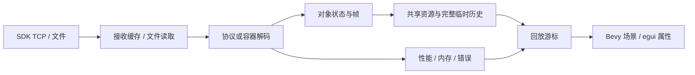

# 架构与边界

pvd-studio 是独立的 Windows 桌面工具，参考 NVIDIA PhysX Visual Debugger 3（PVD3）的功能与工作流程。物理状态来自 SDK 捕获，展示端不运行物理模拟。协议、历史和分析可以脱离 Bevy/egui 使用。

## 模块

| 模块 | 职责 | 边界 |
| --- | --- | --- |
| `pvd-protocol` | 有界字节解析、communication stream 版本、动态元数据和原始事件 | 不承担 UI、网络或历史存储 |
| `pvd-core` | 对象生命周期、属性/引用、帧、历史、回放、分析、容器和导出 | 不依赖网络与渲染框架 |
| `pvd-transport` | TCP 监听、原始捕获、接收缓存、有界交付和取消 | 不解释物理对象或运行模拟 |
| `pvd-cli` | 捕获、检查、验证、CSV、SDK 裁剪和 RepX | 不依赖桌面运行时 |
| `pvd-desktop` | 会话调度、Bevy 场景映射、egui 面板与输入 | 使用共享核心，不另写协议或历史引擎 |
| `tools` | 真实 SDK 生产器、验证、诊断和打包 | 生产器是测试数据源，不参与回放 |
| `test-support` | 多个测试目标共用的夹具 | 随源码保留，测试使用相对路径引用 |
| `vendor` | 固定发布版本的项目内补丁及许可证 | 不修改全局 Cargo registry 或系统配置 |

运行时依赖通过 `Cargo.lock` 固定；`bevy_winit` 和 `egui_dock` 使用 workspace 的 `[patch.crates-io]`，排除出成员但参与构建。补丁的来源和回归边界见[窗口补丁](../vendor/bevy_winit/PVD-STUDIO-PATCH.md)与[停靠补丁](../vendor/egui_dock/PVD-STUDIO-PATCH.md)。

## 数据路径

`RecordingSource` 区分 SDK 原始流、PVD3 原版容器和项目捕获。输入根据内容签名分流，扩展名只用于用户选择和输出约束。未知事件边界拒绝解析，不猜测长度或跳过未理解的事件。

| 来源 | 恢复方式 | 格式边界 |
| --- | --- | --- |
| SDK communication stream | 动态元数据、协议事件和帧边界建立核心状态 | SDK 直写 `.pxd2` 仍是 SDK 流，不等于 PVD3 保存容器 |
| PVD3 client database v1 | `native` 随机读取元数据、页、初始实例及保存目录，再接入核心动作和磁盘历史 | 字节切片限 512 MiB；文件读取受元数据/当前状态/磁盘预算限制，真实大型、多页及非空首快照配对仍有限 |
| 项目 `.pvdcapture` | 从索引、来源目录、基线和共享资源恢复选定区间 | 版本和旧格式读取见[项目捕获](retained-capture.md)；不包含完整 SDK 原始字节 |

SDK 的 `frame` / `ApexFrame` 按捕获顺序建立全局索引，各来源另存自己的序号；导航和逐源绘制窗口见[帧来源](frame-sources.md)。原版内部 ID 与旧项目捕获的录制帧轴不反推为原始 SDK 来源。

## 接收、显示与退出

桌面 socket 线程先写入独立磁盘接收分段，另一个线程通过有界内存队列交付解析器。普通 CLI 监听直接使用有界队列，可能形成 TCP 背压。两者都保留协议事件的顺序和完整性；接收线程不持有 Bevy World。

永久原始录制、接收缓存和回放历史是独立存储。暂停或跳帧只改变显示游标，接收和历史写入继续。默认新连接跟随实时，历史过期时保留旧画面并提供恢复入口，不能把旧显示帧冒充仍保留的帧。

换源、关闭或新定位会取消过期工作。结果带会话/请求代际，晚到结果不能覆盖新游标；增量以已经发布的显示状态为基准。退出会取消并等待后台导出、索引和缓存清理，完成后再结束应用。强制终止仍可能留下可识别的临时文件。

协议损坏或当前场景资源不足会停止解码。历史写入和分析失败有独立诊断，在可继续解析时允许当前场景继续；接收字节数不能证明场景正在更新。详见[持续实时](continuous-live.md)、[接收清理](receive-cache-cleanup.md)和[后台退出](background-shutdown.md)。

## 历史与连续回放

内部历史格式 `PVDHIS03` 服务当前会话，不是 PVD3 数据库或可直接重开的持久格式。对象版本、大属性、几何和分析页跨时间分段共享；分段持有资源根与目录，按保留引用回收。内容按哈希和实际字节比较去重。

帧索引以每页 256 项共享。完成页保持不可变，追加只复制必要的尾页与目录。写入按资源、帧/检查点、索引发布的顺序提交，失败不发布半帧。淘汰使段租约失效，旧快照不能无限钉住历史；物理额度计入在途读取、整理空间及删除失败文件。

连续正放跨段应用帧变化。反向优先使用最多 120 帧/8 MiB 的内存索引撤销，未命中时可读取有效的持久 Scene Undo；缺少记录时恢复检查点。取消、换源或未发布结果替换会清除对应游标。

场景撤销不包含完整 Analysis。默认共享分页分析以有界根缓存和磁盘基线恢复；场景与分析按需加载，目标根未命中时仍可能向前重放分析输入。冷定位、超出缓存的倒放和随机定位不保证恒定耗时。

目录为当前工作目录的 `pvd-cache/history`，默认热历史预算 8 GiB。完整模式在热数据回收前封存历史，旧帧按需读取冷存储；活动录制总占盘受剩余空间与独立导航边界约束，到限停止追加并保留起点。显式滚动模式仍可淘汰最早数据。完整额度与所有权见[共享历史](shared-history.md)，临时条目生命周期见[完整临时录制](temporary-recordings.md)，独立持久化见[项目捕获](retained-capture.md)。

## 容器与分析语义

PVD3 对象与 profile zone 使用容器内部 ID，性能 Context 保留 SDK 源值。固定阶段只使用有效且唯一的 Scene 生命周期→SDK 源映射；源指针复用或缺失映射不会被猜测为有效归属。通用事件曲线使用显式参考 Scene 的时间窗口，名称来自保存时目录。

内存记录按缓冲送达的刷新帧归属，不表示精确分配时刻。录制结束状态可能包含最后完成帧之后的刷新。原版错误保留为独立无时间戳列表，不伪造发生时间或受影响 Actor；SDK 原始错误仍保留来源时间信息。

原版磁盘录制的显示分析与录制结束分析分别持有共享根。完整 CSV 和曲线遍历持久帧根及尾部，每个根只贡献新送达记录；显示定位不改变全历史范围，也不将晚送达跨度按接收帧代替实际时钟归属。

原版 renderer 事件保留容器内部实例身份，按捕获帧清空绘制。已有真实配对覆盖 JointFrames、四类限位、RGB 三角形及同帧多次提交；点/线/文本/非空批量和特殊重建仍需真实样例。相机目录映射到捕获相机与生命周期，显示目录按存在位恢复保存时的设置，见[相机与显示属性](native-settings.md)。

OriginShift 先完成有界规划、布局和代际验证，再提交已有属性动作；历史恢复使用捕获旧值，不依靠反向浮点加法。固定 SDK 和对象范围见 [OriginShift](origin-shift.md)，未覆盖坐标域见[路线图](roadmap.md)。

## 展示与资源

Bevy 相机渲染到图像，egui 面板决定视口像素尺寸并显示纹理。对象树、属性与视口共享选择身份。输入限定于有效视口和焦点上下文，文字编辑、IME 和失焦不会触发相机移动。停靠浮窗属于应用窗口内部。

图形资源按共享键复用并在最后使用者释放后回收；当前 ECS 只保存展示需要的状态。内存预算分别约束输入、场景、分析、历史元数据、队列和几何，不构成整个进程或 GPU 的硬内存上限。

空闲按事件刷新，播放和数据发布主动唤醒。离屏 GPU 完成、核心 seek 耗时、TCP 模型提交间隔和原生窗口帧率属于不同测量，不能互相替代。
