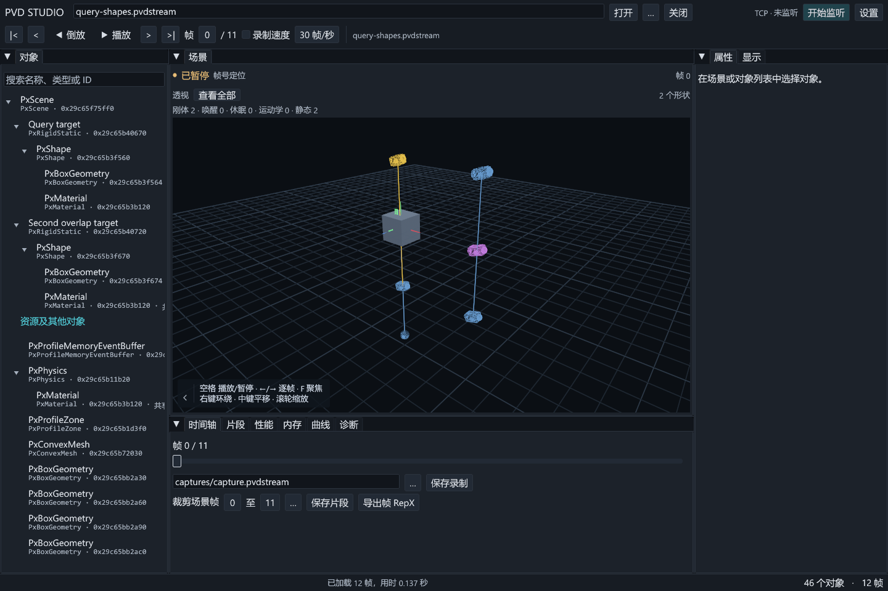
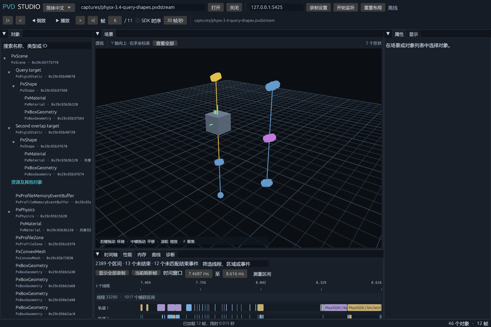

# 界面示例

此处保留经过选择的界面图，用于说明场景、对象树、属性和分析面板的关系。当前功能、默认设置和限制以[项目说明](../../README.zh-CN.md)与[兼容矩阵](../compatibility.md)为准。

## 工作区

界面示例使用 PhysX 3.4.2 查询形状捕获，第 0 帧、1440×960 无窗口 GPU 渲染。顶部区分接收与回放，配置位于“设置”，左下角提示播放和相机操作。图中未选择对象，属性页为空；布局约定见[界面说明](../ui.md)。

左下角的细线箭头折叠柄固定在提示左侧，收起后仅保留同一入口；“显示 → 操作提示”提供相同开关。时间轴保存按钮按来源保存项目历史或 SDK 原始流，默认路径位于 `captures/`；磁盘历史的原始流另存位于单独菜单。

## 场景查询与线程时间线

图像使用 PhysX 3.4.2 查询捕获，展示查询形状、对象关系与线程性能区间。连接设置以程序配置为准。

生成方法见[查询形状](../query-shapes.md)、[线程时间线](../profile.md)与[无窗口验收](../acceptance-plan.md)。生成的检查图片不随源码提交。
